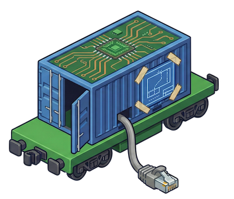

# Flatcar Homelab

{ align=right width=150 }

A rack of machines and a pile of YAML: a bare metal Kubernetes cluster that
provisions itself over PXE, keeps its entire state in Git, and is documented
here so that nothing has to be re-derived at 02:00.

## Start here

- **I want to build this**

    ---

    [Adapt It to Your Cluster](adapting.md) first — the repository URL, domain
    and addresses are hardcoded — then the [Quickstart](quickstart.md). Set
    aside an afternoon.

- **I know Kubernetes, not this repo**

    ---

    [Architecture](architecture/index.md) for how it fits together,
    [Design Decisions](architecture/decisions.md) for why, and
    [Known Limitations](architecture/limitations.md) for what it does not do.

- **I am learning Kubernetes**

    ---

    These pages assume you can use `kubectl`; the
    [Kubernetes basics tutorial](https://kubernetes.io/docs/tutorials/kubernetes-basics/)
    gets you there. Then [Core Concepts](concepts.md) for the five ideas
    underneath this cluster and the terms the other pages use.

- **Something is broken**

    ---

    [Operations](operations/index.md) has the health check and the
    symptom-to-cause table. If it is a stalled install, the
    [PXE troubleshooting table](quickstart.md#troubleshooting-pxe-boot).

- **I am making a change**

    ---

    [Development](development/index.md) for the checks a pull request must
    pass, [GitOps Strategy](architecture/gitops.md) for what a merge does to
    the cluster, and the
    [repository layout](architecture/index.md#repository-layout) for where
    things live.

## The stack in one table

Each choice had a simpler alternative that was rejected on purpose; the
reasoning and what each one costs is in
[Design Decisions](architecture/decisions.md).

| Layer | Choice | Why it is not the obvious one |
| --- | --- | --- |
| OS | [Flatcar Container Linux](concepts.md#flatcar-container-linux) | Read-only `/usr`. You cannot `apt install` your way out of a problem, which turns out to be the feature |
| Cluster | Kubernetes via kubeadm | Stock upstream, so the upstream docs apply verbatim |
| Network | [Cilium](platform/cilium.md) | eBPF, no `kube-proxy`, no iptables archaeology. Also supplies Gateway API and the LoadBalancer addresses bare metal does not come with |
| Storage | [Rook-Ceph](platform/rook-ceph.md) | Replicated block storage across the nodes, and the component most likely to teach you humility |
| Secrets | [OpenBao](platform/openbao.md) | Nothing sensitive in Git, at the price of a manual unseal after every reboot |
| Delivery | [ArgoCD](architecture/gitops.md) | If it is not in Git it is not real, and it will not survive the next reconcile |

The sections follow the reader's journey: [Get Started](adapting.md) to build
it, [Architecture](architecture/index.md) to understand it,
[Platform](platform/index.md) for each of the components,
[Operations](operations/index.md) to run it, and
[Development](development/index.md) to work on the repository.
