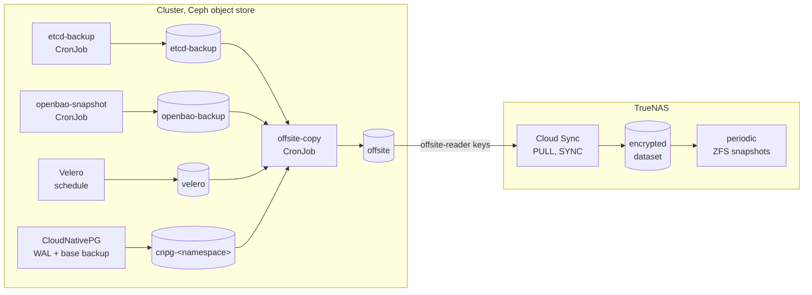

# Backups & Recovery

Every mechanism below is described by what it can get back, and by what it
cannot.

## Current state

| Data | Backed up | How |
| --- | --- | --- |
| Kubernetes objects | Nightly | [Velero](#velero) to the Ceph object store |
| Ceph RBD volumes (PVCs) | Nightly | Velero CSI snapshot, moved into the object store |
| PostgreSQL databases | Continuous WAL, nightly base backup | [CloudNativePG's Barman Cloud plugin](../platform/cloudnative-pg.md#backups), one bucket per database; restores to a point in time |
| Grafana dashboards | Nightly | Its PVC is covered by the above |
| etcd (raw) | Nightly | [CronJob](#etcd) to the object store |
| OpenBao secrets | Nightly | [Raft snapshot CronJob](#openbao) to the object store |
| OpenBao unseal keys | Manual, off-cluster | Printed once at `bao operator init` |
| Prometheus metrics | **No** | Its PVC carries `velero.io/exclude-from-backup`; metrics live for the `retention` in `payload/platform/monitoring/application.yaml`, then are gone |
| Trivy reports and vulnerability database | **No** | `trivy-system` is excluded; the operator rescans and the server downloads the database again |
| Everything in `payload/` | Yes | It is in Git |

## Backup chain

Each night the backups land in the cluster's own buckets, one CronJob gathers
them into `offsite`, and TrueNAS pulls that bucket and snapshots it. Each step
runs after the one before has finished, so nothing is copied while it is
being written.



| Step | Scheduled in | When |
| --- | --- | --- |
| etcd, OpenBao, Velero, databases | Their CronJobs, `payload/platform/velero/application.yaml` and each `ScheduledBackup`, in UTC | Through the night, never overlapping |
| `offsite-copy` | `payload/platform/backup/offsite-copy.yaml`, in UTC | After the last of the above |
| TrueNAS Cloud Sync task | The NAS | 07:00 local time, two hours after the copy starts in winter and one in summer |
| TrueNAS periodic snapshot task | The NAS | 09:00 local time, after the pull |

The TrueNAS times are not in Git, so this table is their only record: change
them here when they change on the NAS.

## What is not covered

**Every automated backup lands in the same cluster's Ceph first.** That
protects against operator error (a deleted PVC, a bad `prune`, a corrupted
database) and not against losing the cluster, so a TrueNAS box pulls a copy
of every backup bucket nightly; see [Off-cluster copy](#off-cluster-copy). Disaster
recovery is **Git, the OpenBao unseal keys, and that copy**. The NAS sits on
the same LAN, so a fire or theft that takes the cluster can take the copy too;
nothing leaves the house yet.

Velero's `PrometheusRule` reports a backup that failed
(`VeleroBackupFailures`, `VeleroBackupPartialFailures`); only
`VeleroBackupTooOld` notices one that silently stopped, since a backup hung
`InProgress` never fails ([Velero](../platform/velero.md#configuration)). All
of them only reach whoever Alertmanager is configured to tell — see
[Monitoring](../platform/monitoring.md).

## Velero

[Velero](https://velero.io/) backs up Kubernetes objects and volume data
nightly. Chart values and why each is set are in
[Velero](../platform/velero.md).

| Property | Value |
| --- | --- |
| Schedule | The `schedules` block in `payload/platform/velero/application.yaml`: nightly, an hour after etcd so the two never contend for the object store, with a TTL of two weeks so a bad backup is noticed before the last good one expires |
| Scope | All namespaces except `kube-system` (rebuilt from Git, and large) and `trivy-system` (rescanned), minus `events` (they expire anyway) and any PVC labelled `velero.io/exclude-from-backup`, which is only Prometheus's: the chart's `volumeClaimTemplate.metadata.labels` carries it |
| Destination | `offsite/backup.velero/` in the [Ceph object store](../platform/rook-ceph.md), written as its own [backup writer](../platform/rook-ceph.md#backup-writers) |
| Volume data | CSI snapshot, streamed into the object store by the data mover (Kopia), snapshot deleted; the durable copy is the one in the object store |
| Encryption | Volume data with the repository password generated into OpenBao at `velero/repository`, which a restore needs; resource backups, Secrets included, are plain JSON — see [Repository password](../platform/velero.md#repository-password) |

The `velero` CLI defaults to the `velero` namespace; this install is in
`backup`, so pass `-n backup` every time.

```bash
kubectl -n backup get backups.velero.io
kubectl -n backup get backupstoragelocation     # should be Available

velero -n backup backup create manual-$(date +%s) --include-namespaces my-app
```

Backups in `PartiallyFailed` with no volume data mean Velero found no
`VolumeSnapshotClass` labelled `velero.io/csi-volumesnapshot-class: "true"`
and skipped the volumes silently — check
`payload/platform/backup/volumesnapshotclass.yaml` is applied.

## etcd

Velero restores *through* the API server, which is no use with no API server
left (lost quorum, a corrupted data directory). For that a CronJob in
`payload/platform/backup/etcd-backup.yaml` snapshots etcd nightly, an hour
before Velero runs.

| Property | Value |
| --- | --- |
| Schedule | `payload/platform/backup/etcd-backup.yaml`: nightly, before Velero |
| Where it runs | Any control-plane node, on the host network: etcd listens on `127.0.0.1` and its client certs are on the node. It mounts the CA certificate and the healthcheck client pair, never the directory, which also holds the CA and server keys |
| Verification | `etcdutl snapshot status` before upload, so a truncated snapshot fails the job instead of replacing a good backup (`etcdctl snapshot status` was removed in etcd 3.6) |
| Destination | `offsite/backup.etcd/`, separate from Velero's because it is restored by different means; the job keeps the newest snapshots and deletes the rest, the count is in the manifest |

Two settings there are easy to undo by accident: the DNS policy for a
host-network pod (the node's `resolv.conf` cannot resolve the RGW Service), and
the AWS CLI config file selecting path-style addressing (no environment
variable sets it).

```bash
kubectl -n backup get cronjob etcd-backup
kubectl -n backup logs job/<most-recent-job> -c upload
```

### Defragmentation

The API server compacts etcd's history every five minutes, but compaction
only frees pages inside the database file; the file itself never shrinks until
a member is defragmented, and once less than half of it is in use
`etcdDatabaseHighFragmentationRatio` fires. A second CronJob in
`payload/platform/backup/etcd-defrag.yaml` runs `etcdctl defrag --cluster`
nightly from the same kind of host-network pod as the backup, one member after
another, and prints `endpoint status` before and after so the log shows the
size reclaimed.

| Property | Why |
| --- | --- |
| Nightly | This cluster's churn crosses the alert's ratio about a day and a half after a defrag, so the alert firing means a run failed or did not help, not that the next one is due |
| One member at a time | A member blocks for seconds while it rewrites its file; the other two keep quorum |
| Fails when a member is unreachable | `endpoint status --cluster` exits non-zero, so a cluster already short of a member is not defragmented |

```bash
kubectl -n backup get cronjob etcd-defrag
kubectl -n backup create job --from=cronjob/etcd-defrag etcd-defrag-manual
kubectl -n backup logs job/etcd-defrag-manual
```

### Taking one by hand

The snapshot lands in the static pod's `/var/lib/etcd`, which is the node's;
`kubectl cp` cannot fetch it, because the etcd image is distroless and has no
`tar`.

```bash
kubectl -n kube-system exec -it etcd-<node> -- etcdctl \
  --cacert /etc/kubernetes/pki/etcd/ca.crt \
  --cert /etc/kubernetes/pki/etcd/server.crt \
  --key /etc/kubernetes/pki/etcd/server.key \
  snapshot save /var/lib/etcd/snapshot.db

ssh <node> sudo cat /var/lib/etcd/snapshot.db > ./etcd-snapshot.db
ssh <node> sudo rm /var/lib/etcd/snapshot.db
```

Keep the copy off the cluster, like the nightly ones below.

## OpenBao

A CronJob in `payload/platform/backup/openbao-snapshot.yaml` saves a Raft
snapshot nightly, between the etcd snapshot and Velero.

| Property | Value |
| --- | --- |
| Login | Kubernetes auth as the `openbao-snapshot` role, whose policy reads `sys/storage/raft/snapshot` and nothing else; `make bao-policies` writes it — see [Kubernetes auth](../platform/openbao.md#kubernetes-auth). The token is revoked when the snapshot is saved |
| Verification | The archive must list its `SHA256SUMS`, so a truncated snapshot fails the job instead of replacing a good one |
| Destination | `offsite/backup.openbao/`; the job keeps the newest snapshots and deletes the rest, the count is in the manifest |
| CLI version | The job's image is grouped with the server's tag in Renovate, so the CLI never lags the server |

```bash
kubectl -n backup get cronjob openbao-snapshot
kubectl -n backup create job --from=cronjob/openbao-snapshot openbao-snapshot-manual
kubectl -n backup logs job/openbao-snapshot-manual -c snapshot
```

By hand, with a token that may read the snapshot:

```bash
kubectl -n openbao exec -it openbao-0 -- bao operator raft snapshot save /tmp/snapshot.bao
kubectl -n openbao cp openbao-0:/tmp/snapshot.bao ./openbao-snapshot.bao
```

The snapshot holds all KV data plus policies, roles and mounts. It does **not**
hold the unseal keys and is useless without them — see
[OpenBao](../platform/openbao.md).

## Off-cluster copy

Every night a CronJob gathers every backup bucket into one bucket, `offsite`,
and a TrueNAS box on the LAN pulls that bucket into a ZFS dataset. TrueNAS
pulls rather than the cluster pushing, so nothing in the cluster holds a
credential that could reach the NAS.

| Property | Why |
| --- | --- |
| `offsite-copy` CronJob in `payload/platform/backup/offsite-copy.yaml` | Lists every `ObjectBucketClaim` in the cluster and copies each bucket into `offsite/<bucket>/`, inside the object store, so a new claim is in the next night's copy with nothing to configure. A claim is left out only by the label `homelab.wlkr.ch/offsite-copy: "false"`, which Loki's log bucket and `offsite` itself carry |
| Credentials | The [`offsite-reader`](../platform/rook-ceph.md#off-cluster-reader) S3 user: list and get on each backup bucket through its claim's `bucketPolicy`, and owner of `offsite`. The job and TrueNAS use the same keys; neither can change a backup |
| A claim without the reader's `bucketPolicy` | Fails its copy and the job, so `KubeJobFailed` fires instead of the bucket silently missing from the copy; the other buckets are still copied |
| `BackupCronJobStale` in `payload/platform/backup/prometheusrule.yaml` | Fires when any CronJob in `backup` has not succeeded for a day and a half, which a run that never starts does not report as a failure |
| One Cloud Sync task, `PULL` and `SYNC` | The dataset mirrors `offsite`, so the copy shrinks when a TTL or retention prunes a bucket, and a restore finds each bucket under its own name |
| Periodic ZFS snapshots of the dataset | What `SYNC` deleted, and whatever a broken cluster wrote, is still in an older snapshot. Keep them longer than the cluster's retention, so a bad backup noticed late still has a good one behind it |
| Scheduled after the copy | A Kopia repository or WAL archive copied while it is being written is inconsistent, so the CronJob runs after the last nightly backup and TrueNAS after the CronJob |
| Encrypted dataset | Velero's resource backups are plain JSON with every Secret in them |

A deleted claim's copy stays in `offsite` until it is removed by hand. The
`offsite` bucket is a second copy of the backups inside Ceph; its size is the
sum of the backup buckets.

```bash
kubectl -n backup get cronjob offsite-copy
kubectl -n backup create job --from=cronjob/offsite-copy offsite-copy-manual
kubectl -n backup logs -f job/offsite-copy-manual
```

### Setting up the TrueNAS pull

1. Read the reader's keys from the `offsite-bucket` claim's Secret:
   `AWS_ACCESS_KEY_ID` is the **Access Key ID**, `AWS_SECRET_ACCESS_KEY` the
   **Secret Access Key**.

    ```bash
    kubectl -n backup get secret offsite-bucket -o jsonpath='{.data.AWS_ACCESS_KEY_ID}' | base64 -d; echo
    kubectl -n backup get secret offsite-bucket -o jsonpath='{.data.AWS_SECRET_ACCESS_KEY}' | base64 -d; echo
    ```

2. Under **Credentials → Backup Credentials → Cloud Credentials**, add an
   `Amazon S3` credential with those keys, **Endpoint URL**
   `https://s3.infra.k8s.wlkr.ch` and **Region** `eu-central-1`.
3. Create an encrypted dataset for the copy.
4. Under **Data Protection → Cloud Sync Tasks**, add one task: direction
   `PULL`, transfer mode `SYNC`, bucket `offsite`, the dataset as the target,
   scheduled after the CronJob has finished: 07:00 local time, see
   [Backup chain](#backup-chain). `kubectl -n backup get jobs` shows how long
   the CronJob takes.
5. Under **Data Protection → Periodic Snapshot Tasks**, snapshot the dataset
   after the Cloud Sync task, at 09:00 local time, with a lifetime longer than
   the cluster's retention.
6. Run the Cloud Sync task once by hand and confirm it ends `SUCCESS`.

### Checking the reader

From any machine on the LAN, with the reader's keys exported as
`AWS_ACCESS_KEY_ID` and `AWS_SECRET_ACCESS_KEY`, `offsite` is listed and a
backup bucket refuses a write:

```bash
export AWS_CONFIG_FILE=$(mktemp)    # path-style addressing, without touching ~/.aws
printf '[default]\ns3 =\n    addressing_style = path\n' > "$AWS_CONFIG_FILE"
aws --endpoint-url https://s3.infra.k8s.wlkr.ch --region eu-central-1 s3 ls                # offsite
echo test | aws --endpoint-url https://s3.infra.k8s.wlkr.ch --region eu-central-1 s3 cp - s3://velero/test   # AccessDenied
```

### Copying a bucket off the cluster

By hand, before a reinstall or for a copy kept elsewhere, the same keys and
config as above:

```bash
aws --endpoint-url https://s3.infra.k8s.wlkr.ch --region eu-central-1 s3 sync s3://<bucket> ./<bucket>
```

Store it like the NAS dataset: with the unseal keys, not beside the Git
clone.

### Restoring from the copy

Velero and CloudNativePG read only from the cluster's own buckets, so a
rebuilt cluster gets each bucket's copy, the `<bucket>/` directory in the
dataset, pushed back first, with the write keys of the new claim, not the
reader's. The etcd and OpenBao restores take the file
straight from the copy.

1. Once Rook has bound the claim again, export that claim's keys and the
   path-style config.

    ```bash
    export AWS_ACCESS_KEY_ID=$(kubectl -n <namespace> get secret <claim> -o jsonpath='{.data.AWS_ACCESS_KEY_ID}' | base64 -d)
    export AWS_SECRET_ACCESS_KEY=$(kubectl -n <namespace> get secret <claim> -o jsonpath='{.data.AWS_SECRET_ACCESS_KEY}' | base64 -d)
    export AWS_CONFIG_FILE=$(mktemp)
    printf '[default]\ns3 =\n    addressing_style = path\n' > "$AWS_CONFIG_FILE"
    ```

2. Push the dataset's copy, mounted or copied from the NAS, into the bucket.

    ```bash
    aws --endpoint-url https://s3.infra.k8s.wlkr.ch --region eu-central-1 s3 sync ./<bucket> s3://<bucket>
    ```

## Ceph volumes

PVCs are covered by [Velero](#velero). Ceph's own replication is not a backup:
it spreads each block across OSDs, which survives a disk or node failing and
nothing else. Almost every Application runs with `prune: true` (`kube-vip` and
`security` are the deliberate exceptions), so removing a
`PersistentVolumeClaim` from Git deletes the volume.

## Restoring

The commands are the upstream-documented ones for the versions pinned in
`payload/platform/`; the etcd sequence has not been exercised on this cluster.

### Velero restore

1. Find the backup.

    ```bash
    velero -n backup backup get
    ```

2. Restore from it, scoped to what was lost; without `--include-namespaces`
   everything in the backup is restored, and existing objects are skipped, not
   overwritten.

    ```bash
    velero -n backup restore create --from-backup velero-daily-<timestamp> \
      --include-namespaces my-app
    ```

3. Watch it finish and read the warnings.

    ```bash
    velero -n backup restore describe <restore-name>
    velero -n backup restore logs <restore-name>
    ```

### OpenBao snapshot restore

Needs an initialised, unsealed cluster and a root token from
[Generating a root token](../platform/openbao.md#generating-a-root-token). Afterwards
the snapshot's own operator login applies, not the new cluster's. `-force` is what
lets a snapshot from a *different* cluster (a fresh `bao operator init`) load;
afterwards the pods seal and want the snapshot's keys, not the new cluster's.

1. Copy the snapshot in.

    ```bash
    kubectl -n openbao cp ./openbao-snapshot.bao openbao-0:/tmp/snapshot.bao
    ```

2. Restore it.

    ```bash
    kubectl -n openbao exec -it openbao-0 -- \
      env BAO_TOKEN=<root-token> bao operator raft snapshot restore -force /tmp/snapshot.bao
    ```

3. Unseal every replica with the snapshot's key shares and confirm. The script
   reads `output/credentials/openbao-init.json`, which now holds the new
   cluster's keys, so point it at the old file with `KEYFILE`.

    ```bash
    KEYFILE=<old openbao-init.json> make bao-unseal
    kubectl -n openbao exec openbao-0 -- bao status   # Sealed: false
    ```

4. Put the old key and operator files in place of the new ones, which unseal
   nothing any more; every later `make bao-*` reads them.

    ```bash
    mv <old openbao-init.json> output/credentials/openbao-init.json
    mv <old openbao-operator.json> output/credentials/openbao-operator.json
    ```

### etcd restore

Every etcd member restores from the same snapshot, then all three static pods
come back together. Flatcar ships no `etcdutl`, so run it from the etcd image
the CronJob uses. Upstream:
[Restoring an etcd cluster](https://kubernetes.io/docs/tasks/administer-cluster/configure-upgrade-etcd/#restoring-an-etcd-cluster).

1. Copy the snapshot, from `backup.etcd/` in the off-cluster copy
   ([Off-cluster copy](#off-cluster-copy)),
   to every control-plane node as `/var/lib/etcd-restore/snapshot.db`.
2. On every control-plane node, stop the API server and etcd by moving their
   static pod manifests out, and wait until neither container is listed.

    ```bash
    sudo mkdir -p /root/manifests-stopped
    sudo mv /etc/kubernetes/manifests/{etcd,kube-apiserver}.yaml /root/manifests-stopped/
    sudo crictl ps --name 'etcd|kube-apiserver'    # empty
    ```

3. On every control-plane node, pull the etcd image the CronJob uses (the tag
   is in `payload/platform/backup/etcd-backup.yaml`). Only the node that last
   ran the CronJob has it; `ctr run` does not pull.

    ```bash
    sudo ctr -n k8s.io image pull registry.k8s.io/etcd:<tag>
    ```

4. On every control-plane node, restore into a new data directory with the
   `--name`, `--initial-cluster` and `--initial-advertise-peer-urls` values
   from that node's `/etc/kubernetes/manifests/etcd.yaml`, and one
   `--initial-cluster-token` that is the same on every node and differs from
   the old cluster's, so a member that missed the restore cannot rejoin the new
   one.

    ```bash
    sudo ctr -n k8s.io run --rm \
      --mount type=bind,src=/var/lib/etcd-restore,dst=/restore,options=rbind:rw \
      registry.k8s.io/etcd:<tag> etcd-restore \
      etcdutl snapshot restore /restore/snapshot.db --data-dir /restore/etcd \
        --name <node> --initial-cluster <name=https://ip:2380,...> \
        --initial-cluster-token <new-token> \
        --initial-advertise-peer-urls https://<node-ip>:2380
    ```

5. Swap the data directory in, keeping the old one and its ownership.

    ```bash
    sudo mv /var/lib/etcd /var/lib/etcd.bak
    sudo mv /var/lib/etcd-restore/etcd /var/lib/etcd
    sudo chown -R --reference=/var/lib/etcd.bak /var/lib/etcd
    ```

6. Put the manifests back on every node, then confirm.

    ```bash
    sudo mv /root/manifests-stopped/*.yaml /etc/kubernetes/manifests/
    kubectl get nodes
    kubectl -n argocd get applications     # ArgoCD reconverges from Git
    ```

### Rebuild from scratch

1. Have the Git repository, the OpenBao unseal keys and operator login, and
   the [off-cluster copy](#off-cluster-copy) of `backup.openbao/` and
   `backup.velero/`; an etcd snapshot from it is optional and skips
   re-issuing certificates.
2. Move the old `openbao-init.json` and `openbao-operator.json` out of
   `output/credentials/`: `make bao-init` refuses while either exists, because
   keys from another cluster unseal nothing.
3. Provision the cluster per the [Quickstart](../quickstart.md) from step 1.
4. When every `ExternalSecret` is Degraded, `make bao-init`, then either
   restore the OpenBao snapshot as above, which puts the old files back, or
   re-enter the typed secrets with `make bao-secrets` and let the
   `PushSecret`s generate the rest anew — which loses whatever was encrypted
   with the old keys, Velero's volume backups among them.
5. Once the platform is Synced and Healthy, push the `velero` copy back
   ([Restoring from the copy](#restoring-from-the-copy)) and restore
   workloads with a Velero restore.
