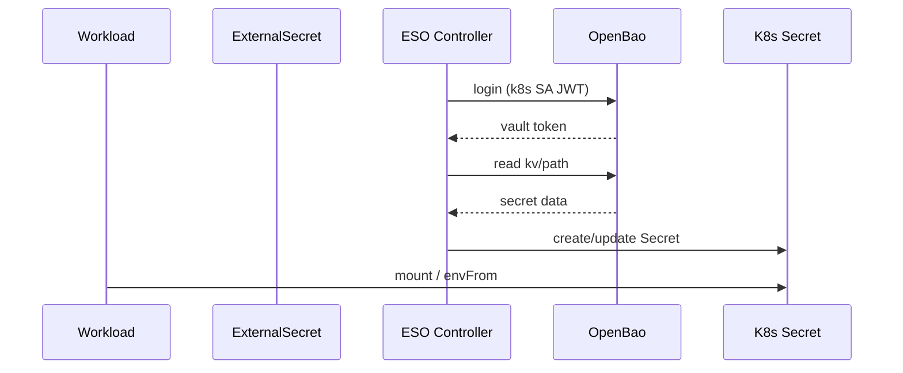

# External Secrets Operator

[External Secrets Operator (ESO)](https://external-secrets.io/) bridges
[OpenBao](openbao.md) to native Kubernetes `Secret` objects. Workloads consume
secrets the standard way — `envFrom`, `volumeMounts`, `imagePullSecrets` —
with no sidecar, no init container and no code that knows what a Vault token
is.

## At a glance

| | |
| --- | --- |
| Namespace | `external-secrets` |
| Depends on | [OpenBao](openbao.md) at runtime, though not to be installed |
| If it is down | Secrets already materialised keep working. Nothing rotates, and nothing new resolves |
| Health check | `kubectl get clustersecretstore` &rarr; `Valid` on all three |
| Files | `payload/platform/external-secrets/`; the stores in `payload/platform/openbao/cluster-secret-store.yaml` |

## Configuration



ESO mints a short-lived token for an `external-secrets-vault` ServiceAccount
through the TokenRequest API, which the chart's controller ClusterRole allows
in every namespace; OpenBao validates it against the TokenReview API
and issues a token bound to that store's policy. Platform namespaces use the
`openbao` store and the ServiceAccount in `external-secrets`; a workload uses
`openbao-apps` and its own, which confines it to `kv/<namespace>/` — see
[Kubernetes auth](openbao.md#kubernetes-auth). No long-lived credential exists
anywhere. The stores use ESO's `vault` provider unchanged against the
in-cluster Service.

| Setting | Why |
| --- | --- |
| No `ClusterSecretStore` here | A store only validates against a running, unsealed OpenBao, so it ships with `openbao`, whose readiness it reports — see [Bootstrap convergence](../architecture/gitops.md#bootstrap-convergence) |
| Webhook ServiceAccount token stays mounted | The webhook has no RoleBinding but builds an in-cluster client at startup and exits without the token (`unable to load in-cluster config`), which only shows when the pod is recreated |

## Usage

### Adding a secret

1. Store the value in OpenBao, following the [KV layout](openbao.md#kv-layout).
   A random value is not typed in at all: a `Password` generator and a
   `PushSecret` write it, see [Generated secrets](openbao.md#generated-secrets).

    ```bash
    bao kv put kv/<workload>/<purpose> key1="value1" key2="value2"
    ```

2. Declare an `ExternalSecret` alongside the workload's other manifests; the
   parent Application picks it up. A workload names `openbao-apps` and ships
   the ServiceAccount that store logs in as; a platform component names
   `openbao` instead and needs no ServiceAccount:

    ```yaml
    ---
    apiVersion: v1
    kind: ServiceAccount
    metadata:
      name: external-secrets-vault
      namespace: my-app
      annotations:
        argocd.argoproj.io/sync-wave: "-2"
    automountServiceAccountToken: false
    ---
    apiVersion: external-secrets.io/v1
    kind: ExternalSecret
    metadata:
      name: my-app-credentials
      namespace: my-app
      annotations:
        # ESO's CRDs arrive with the external-secrets Application; this
        # covers a sync before they have landed.
        argocd.argoproj.io/sync-options: SkipDryRunOnMissingResource=true
    spec:
      refreshInterval: 1h
      secretStoreRef:
        name: openbao-apps
        kind: ClusterSecretStore
      target:
        name: my-app-credentials   # name of the resulting K8s Secret
        creationPolicy: Owner
      data:
        - secretKey: key1           # key in the K8s Secret
          remoteRef:
            key: my-app/<purpose>   # the namespace is the prefix
            property: key1          # key inside the KV entry
    ```

    To pull every key without listing them, use `dataFrom` instead of `data`:

    ```yaml
    spec:
      dataFrom:
        - extract:
            key: <workload>/<purpose>
    ```

3. Consume the Secret:

    ```yaml
    spec:
      containers:
        - name: my-app
          envFrom:
            - secretRef:
                name: my-app-credentials
    ```

`refreshInterval` polls OpenBao; `0` disables polling and re-syncs only on
resource changes. To sync now rather than wait:

```bash
kubectl annotate externalsecret -n <namespace> <name> \
  force-sync=$(date +%s) --overwrite
```

## Health check

Start with the store; if it is not Ready, nothing downstream is either.
`openbao-apps` and `openbao-claude-agents` report `Valid` without logging in,
so their auth failures show on the `ExternalSecret` instead:

```bash
kubectl get clustersecretstore openbao -o jsonpath='{.status}' | jq
```

| Cause | Fix |
| --- | --- |
| OpenBao is sealed | [Unseal it](openbao.md#unsealing-after-a-restart) |
| Kubernetes auth role missing | `make bao-policies` writes all three roles |
| Wrong `serviceAccountRef` | `external-secrets-vault`, in `external-secrets` for `openbao` and without a namespace for the other two |

Then the individual object:

```bash
kubectl describe externalsecret -n <namespace> <name>
```

| Cause | Fix |
| --- | --- |
| The KV path does not exist (`bao kv get kv/<path>` returns 404) | Store the secret first |
| `property:` matches no key in the KV entry | `bao kv get kv/<path>` lists them |
| `permission denied` from `openbao-apps` | The path is outside `kv/<namespace>/`, or the namespace has no `external-secrets-vault` ServiceAccount |
| `using cluster store ... is not allowed from namespace` | The store's `conditions` exclude the namespace: a workload on `openbao`, or a platform namespace on `openbao-apps` |

## Pitfalls

!!! warning "Rotation does not restart anything"
    A rotated value reaches the `Secret` within `refreshInterval`, but a pod that read it into an environment variable keeps the old one until something restarts it. A rollout, or Reloader-style tooling, is the other half of rotation.
